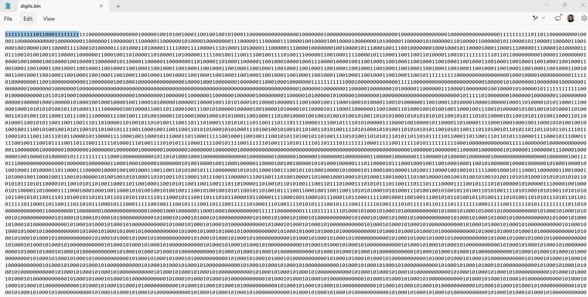
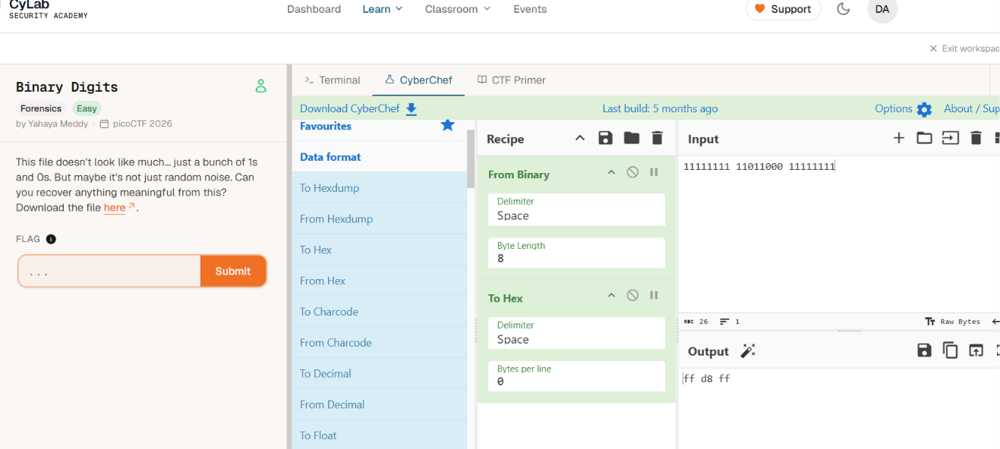
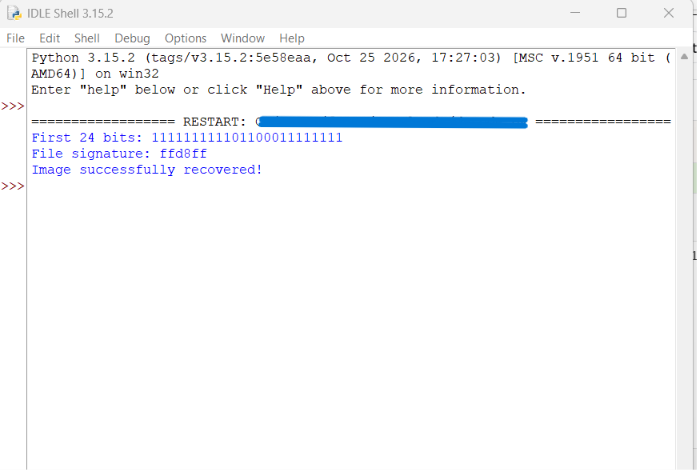
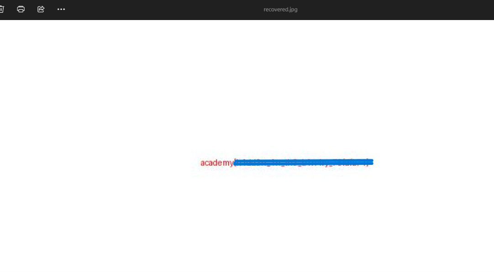
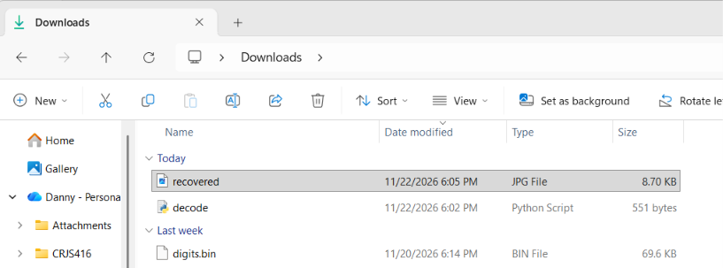
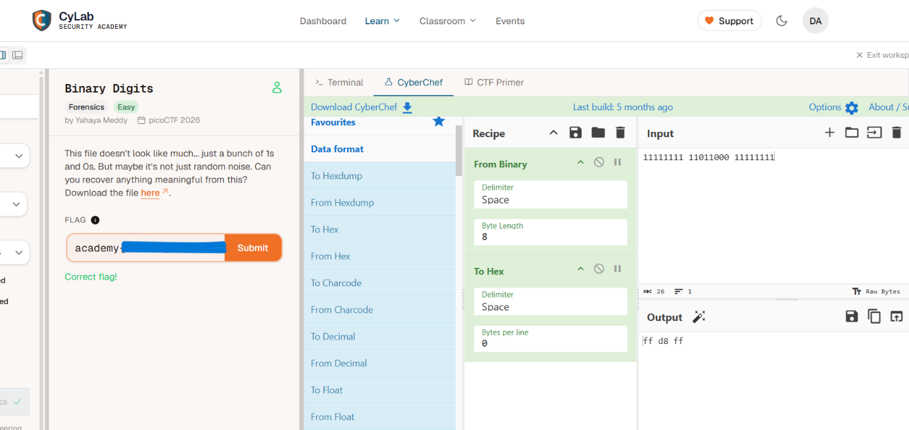

# Binary-Digits-Forensics
Digital forensics investigation involving binary decoding, file signature analysis, and JPEG recovery using CyberChef and Python.
# Binary Digits — Digital Forensics Challenge

**Platform:** CyLab Security Academy / picoCTF 2026  
**Category:** Digital Forensics  
**Difficulty:** Easy  
**Status:** Successfully Completed

## Challenge Overview

The Binary Digits challenge provided a file named `digits.bin` containing a long sequence of 1s and 0s. The objective was to investigate the data, determine whether it contained meaningful information, and recover the hidden flag.

## Tools Used

- Notepad — Initial file inspection
- CyberChef — Binary-to-hexadecimal conversion
- Python 3 — Binary decoding and file reconstruction
- Windows File Explorer — File verification

## Investigation and Methodology

### Step 1: Inspecting the Binary File

I downloaded `digits.bin` and opened it in Notepad. The file contained a continuous sequence of binary digits.



### Step 2: Identifying the File Signature

I examined the first 24 binary digits:

`11111111 11011000 11111111`

Using CyberChef, I applied the **From Binary** and **To Hex** operations.

The resulting hexadecimal values were:

`FF D8 FF`

These values match the beginning of a JPEG file signature, indicating that the binary data likely represented an image.



### Step 3: Decoding the Binary Data Using Python

I used Python to read the binary digits, convert each group of eight bits into a byte, and write the resulting data to a JPEG file.

```python
with open("digits.bin", "r") as file:
    binary = file.read().strip()

print("First 24 bits:", binary[:24])

image_data = bytes(
    int(binary[i:i+8], 2)
    for i in range(0, len(binary), 8)
)

print("File signature:", image_data[:3].hex())

with open("recovered.jpg", "wb") as file:
    file.write(image_data)

print("Image successfully recovered!")
```

The script successfully reconstructed the image.



### Step 4: Recovering the Hidden Image

After executing the script, I opened `recovered.jpg` and discovered the hidden flag displayed inside the image.

For portfolio security and challenge integrity, the flag value is not disclosed.



### Step 5: Verifying the Output Files

I confirmed that the original binary file, Python script, and reconstructed JPEG were present in my Downloads folder.



### Step 6: Validating the Challenge

I submitted the recovered flag to CyLab Security Academy and received the confirmation:

**Correct flag!**



## Skills Demonstrated

- Digital forensics investigation
- Binary and hexadecimal conversion
- File signature identification
- CyberChef analysis
- Python scripting
- File reconstruction and validation
- Technical documentation

## Key Takeaways

This challenge demonstrated how information can be encoded as binary text and reconstructed into a usable file.

I learned how to identify JPEG file signatures, use CyberChef to analyze binary data, and write a Python script to recover an image.

The investigation reinforced the importance of examining file contents rather than relying solely on filenames or extensions.

## Conclusion

I successfully recovered the hidden JPEG image and validated the flag through CyLab Security Academy.

This exercise strengthened my foundational digital forensics and Python skills, which are relevant to cybersecurity analysis and incident investigations.
